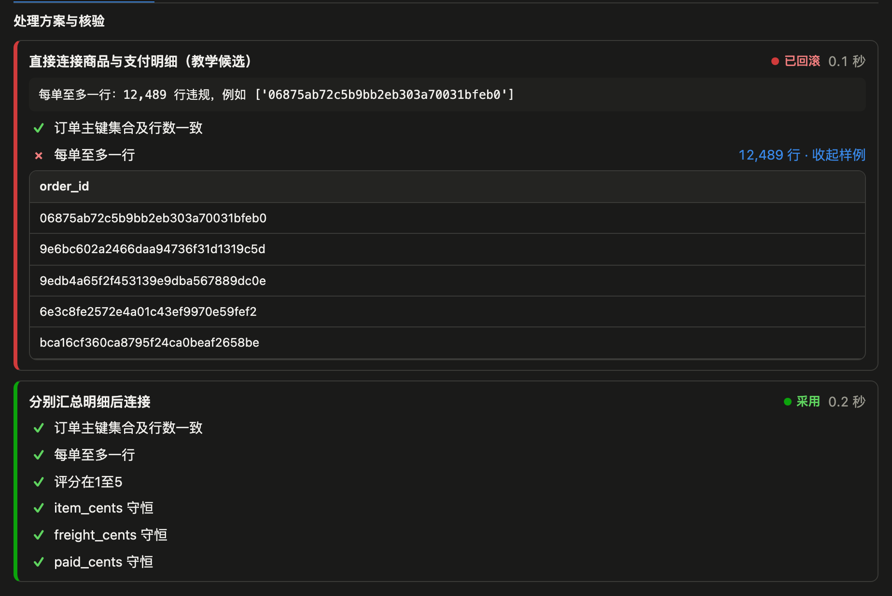
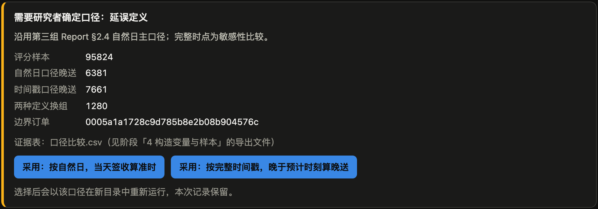
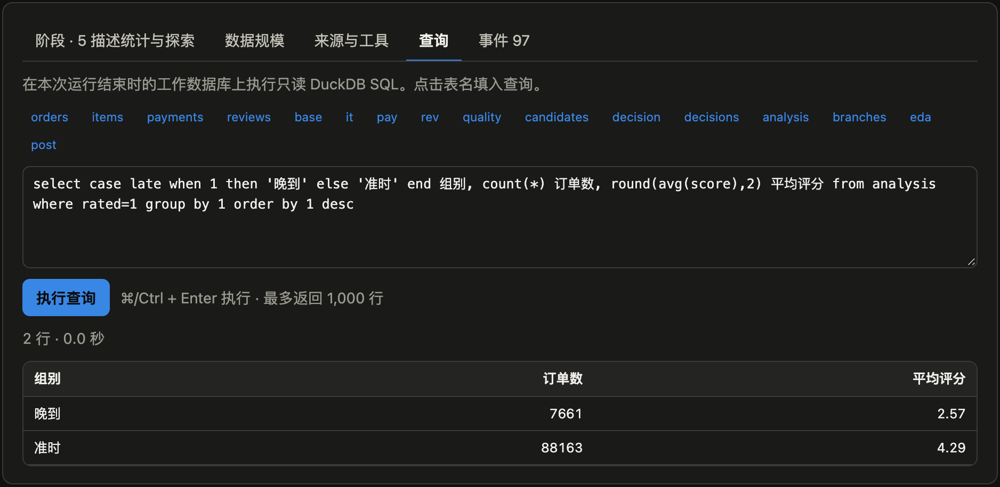
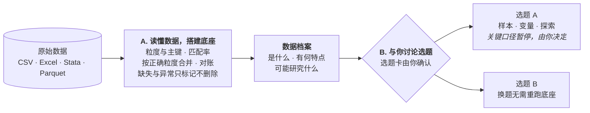

<div align="center">

# Empirical Workbench

### 和 AI 研究助理一起，把一份陌生的数据变成可核验、可复现的实证分析数据

面向经济学与管理学研究者的本地工作台 —— AI 帮你读懂数据、做好清洗与合并，和你讨论确定选题，<br>再完成样本筛选、变量构造与探索分析。每一步都有可回查的 SQL、核验结果和运行记录。

[](https://github.com/xyizhan/empirical-workbench/actions/workflows/test.yml)


[快速开始](#快速开始) · [宣传片](docs/assets/demo.mp4) · [界面一览](#界面一览) · [配置格式](docs/run-format.md) · [English](#english)


<sub>▶ <a href="docs/assets/demo.mp4">观看高清宣传片（48 秒，1080p）</a></sub>

</div>

## 为什么需要它

拿到一份新数据（CSMAR、Wind、CNRDS 的导出，或 Kaggle 上的公开数据），真正耗时的往往不是回归，而是前面这些事：每张表一行代表什么？合并会不会让行数膨胀？缺失和异常怎么处理？哪些定义会改变结论？这些步骤散落在一次性的脚本里，过几个月连自己都说不清。

Empirical Workbench 把这些步骤变成**有证据的工作流**：

| | |
|---|---|
| 🤖 **AI 研究助理** | `ew chat` 在终端里与你合作：先理解数据、搭建底座，再写数据档案、给出可研究方向，和你讨论确定选题 |
| 🧱 **底座与选题分离** | 清洗、合并、对账等与选题无关的工作只做一次；同一份底座可以支撑多个选题，随时换题无需重来 |
| 🙋 **研究者拍板** | 选题卡必须由你在终端确认后，助理才会构造变量；关键口径（如"晚到"怎么定义）运行到该处会暂停并给出证据，由你选择 |
| ✅ **每一步都核验** | 每个阶段附带返回违规行的核验 SQL；失败的方案自动回滚并保留证据，可以看到"为什么这样合并是错的" |
| 🔍 **全程可回查** | 每次运行保存来源文件哈希、全部 SQL、核验结果、各表行数变化、事件流和工作数据库，可随时查询任意中间表 |
| 🖥️ **网页工作台** | `ew serve` 实时查看运行进度、阶段流程、数据规模、导出预览，在页面上做口径决策和 SQL 查询 |
| 🇨🇳 **适配中文数据** | 自动识别 GBK 编码，证券代码等前导零保持文本；读写 CSV、Parquet、Excel、Stata `.dta` |
| 🔓 **开放、本地** | 数据在本地用 DuckDB 处理；模型可接 DeepSeek、OpenAI 或任何兼容 OpenAI 接口的服务。对话时模型会看到助理查询的统计结果与少量样例行，涉密或授权受限的数据可接本地 Ollama |

## 界面一览

<table>
<tr>
<td width="50%"><br><sub><b>每一步都核验</b>：直接连接商品与支付明细会让订单重复（12,489 行违规），方案自动回滚，改为先汇总再合并</sub></td>
<td width="50%"><br><sub><b>关键口径由你决定</b>：运行在「晚到」定义处暂停，列出两种定义的差异与边界订单，点选后以新口径重跑</sub></td>
</tr>
<tr>
<td colspan="2"><br><sub><b>全程可回查</b>：任意中间表都能用 SQL 只读查询，运行记录、导出、独立复算与报告都保存在运行目录中</sub></td>
</tr>
</table>

## 快速开始

需要 Python 3.10+。

```sh
git clone https://github.com/xyizhan/empirical-workbench.git
cd empirical-workbench
python3 -m venv .venv && source .venv/bin/activate
pip install -e '.[formats]'          # formats 可选：读写 Excel 与 Stata .dta
```

### 1. 和研究助理一起处理数据

```sh
export EW_LLM_API_KEY=你的密钥          # 默认使用 DeepSeek
ew chat 我的项目 --raw 原始数据目录      # 首次新建项目；之后 ew chat 我的项目 继续上次对话
```

助理会按这个顺序推进，你可以随时打断、提问或换方向：



### 2. 在网页里查看和决策

```sh
ew serve --runs 我的项目/runs --open
```

### 3. 不用 AI，也能直接用

所有处理都写在可读的 JSON 配置里，可以手写、修改、交给合作者复跑：

```sh
ew inspect 原始数据目录                 # 字段类型、缺失、候选主键、前导零代码提示
ew run 我的项目                         # 运行数据底座
ew run 我的项目 --topic late-delivery   # 运行某个选题（使用最近一次通过的底座）
ew query 我的项目/runs/<运行> "select * from analysis limit 20"
```

## 试一试内置示例

```sh
# 八行企业面板：复合键、年度断档、零基期
ew run studies/panel/study.json --raw studies/panel --out runs/panel-1 --batch
ew view runs/panel-1

# 巴西 Olist 电商（需先从 Kaggle 下载 CSV 到 raw/）：订单、商品、支付、评价四表合并，
# 演示一对多连接被核验拒绝并回滚、口径选择、独立复算和 Quarto 报告
ew run studies/olist/study.json --raw raw --out runs/olist-1 --batch
./demo-olist                            # 课堂投影模式：空格推进，讲者逐步讲解
```

Olist 数据：[Brazilian E-Commerce Public Dataset by Olist](https://www.kaggle.com/datasets/olistbr/brazilian-ecommerce)。

## 命令一览

| 命令 | 作用 |
|---|---|
| `ew chat PROJECT [--raw DIR]` | 与研究助理合作（新建或继续项目） |
| `ew serve [--runs DIR]` | 本地网页工作台（仅监听 127.0.0.1） |
| `ew inspect DIR\|FILE [--json]` | 原始数据画像 |
| `ew run STUDY\|PROJECT [--topic T] [--decision K=V]` | 执行底座、选题或单个研究配置 |
| `ew validate STUDY` | 检查配置，一次列出全部问题 |
| `ew view RUN [--web]` | 在终端或浏览器查看运行 |
| `ew query RUN "SQL"` | 只读查询运行结束时的工作数据库 |
| `ew report RUN [--source-only]` | 生成 Quarto 报告（需安装 Quarto） |
| `ew demo STUDY --raw DIR --out DIR` | 课堂投影模式 |

## 模型配置

只从环境变量读取，密钥不会写入任何文件：

| 变量 | 默认 | 说明 |
|---|---|---|
| `EW_LLM_API_KEY` | — | 也可用 `DEEPSEEK_API_KEY` 或 `OPENAI_API_KEY` |
| `EW_LLM_BASE_URL` | `https://api.deepseek.com` | 例如 `https://api.openai.com/v1`、`http://localhost:11434/v1` |
| `EW_LLM_MODEL` | `deepseek-flash` | 需支持 function calling；数据复杂时可换 `deepseek-v4-pro`（更强但更慢） |

模型只能通过工作台提供的工具操作数据：查询是只读的，写入的配置会先经过校验，选题卡的确认只能来自你在终端的输入。

对话中模型会收到：各字段的类型、缺失与取值范围，助理执行的查询结果（每次最多 200 行），以及运行摘要；原始文件不会整体上传。处理涉密或授权受限的数据时，请把 `EW_LLM_BASE_URL` 指向本地模型。

## 它是怎么工作的

- **配置即流程**：一个研究项目由 `base.json`（数据底座）和 `topics/*.json`（选题）组成。每个阶段写明 SQL、核验与导出；可以列出多个候选方案，失败的方案在事务中回滚，引擎尝试下一个。
- **运行记录**：每次运行写入新目录，包含 `run.json`（格式 `ew.run/1`）、`events.jsonl`、导出文件和 `run.duckdb`。格式说明见 [docs/run-format.md](docs/run-format.md)。
- **独立复算与报告**：研究可以注册复算脚本（`tools`），从原始文件重新计算关键结果；也可以提供自己的报告构建脚本。Olist 示例两者都有。
- **给其他 AI Agent 用**：[skills/empirical-workbench](skills/empirical-workbench/SKILL.md) 是一份 Agent Skill，可交给 Claude、Codex 等宿主 Agent 调用同一套命令。

## 开发

```sh
python -m unittest discover -s tests    # 测试（有 ../data/raw 中的 Olist 数据时会额外跑 Olist 全流程）
ruff check .
cd frontend && npm install && npm run build   # 修改网页前端后重新构建到 ew/web/
```

前端用 Vite + Preact，构建产物随 Python 包发布，使用者无需安装 Node。

宣传片源码在 [promo/](promo/)（Remotion）：`cd promo && npm install && npm run render`，素材是网页工作台的真实截图。

## 路线图

- [ ] 常用操作模板：Stata 式合并诊断、分组缩尾、面板滞后、逐步样本筛选表
- [ ] 网页工作台：项目视图（数据档案、选题卡）、两次运行并排对比
- [ ] 导出复现包：处理后的数据、来源清单、等价脚本与说明
- [ ] 在网页中与研究助理对话

欢迎提交 Issue 和 Pull Request。

## English

**Empirical Workbench** is a local workbench and AI research assistant for empirical economics and management research. Point it at an unfamiliar dataset and `ew chat` will work with you in the terminal: it profiles every table (grain, keys, join coverage), builds a topic-independent *data base* that flags but never drops problematic rows, writes a data profile with possible research directions, and discusses a research question with you. Only after **you confirm the topic card** does it construct samples and variables; definitions that could change conclusions pause the run and wait for your choice. Every step is plain SQL with checks that return violating rows, failed plans roll back automatically, and each run keeps its SQL, checks, source hashes, events and a queryable DuckDB database. Works with DeepSeek or any OpenAI-compatible API. Data is processed locally with DuckDB; during a chat the model sees the summaries and sample rows of the queries the assistant runs, so use a local model (e.g. Ollama) for confidential or licensed data.

```sh
pip install -e '.[formats]'
export EW_LLM_API_KEY=...            # DeepSeek by default; set EW_LLM_BASE_URL / EW_LLM_MODEL for others
ew chat my-project --raw path/to/raw-data
ew serve --runs my-project/runs      # local web workbench
```

## 许可证

[MIT](LICENSE)
